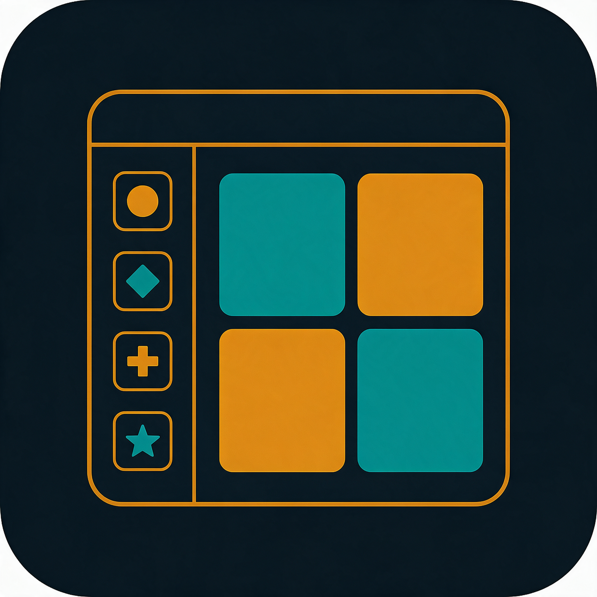
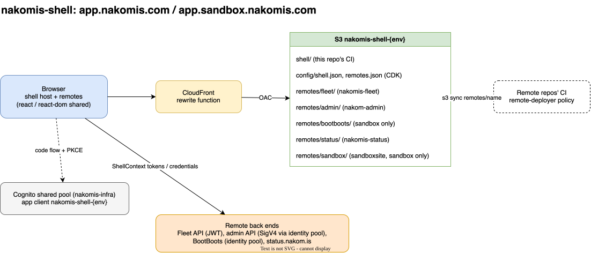

# nakomis-shell — One login, one sidebar, every nakomis app



## Support

If you find this useful, please consider buying me a coffee:

[](https://www.paypal.com/donate?hosted_button_id=Q3BESC73EWVNN&custom=nakomis-shell)

## Table of Contents

<!-- toc -->

- [What it is](#what-it-is)
- [Architecture Diagram](#architecture-diagram)
- [Repository Layout](#repository-layout)
- [Adding a remote](#adding-a-remote)
- [Local development](#local-development)
- [Deploying](#deploying)
- [Architecture Diagrams](#architecture-diagrams)
- [Licence](#licence)
- [Support](#support)

<!-- tocstop -->

## What it is

`app.nakomis.com` (prod) and `app.sandbox.nakomis.com` (sandbox): a Vite + Module Federation **host** that signs
you in once against the shared `nakomis-infra` Cognito pool, shows a sidebar of icons, and mounts each app as a
**remote** loaded at runtime: Fleet, BootBoots, Admin, Scrum, Status and (sandbox only) Sandbox.

## Architecture Diagram



- One CloudFront distribution and one private bucket per env:
  - `shell/` — this app; any extensionless path is rewritten to `shell/index.html`
  - `remotes/<name>/` — each remote's build, published by that remote's own CI
  - `config/shell.json`, `config/remotes.json` — runtime config written by CDK, so one build serves both envs
- Remotes expose `./App`, a React component that receives a `ShellContext` (user, tokens, AWS credentials
  from any identity pool, sign-out). See [`contract/shell-contract.ts`](contract/shell-contract.ts).
- Only `react` and `react-dom` are shared. Each remote brings its own router (with `basename`) and UI library,
  so remotes can upgrade MUI or React Router independently.

## Repository Layout

- `web/` — the host app (Vite 8, React 19, MUI 7, react-oidc-context, `@module-federation/vite`)
- `infra/` — CDK: `NakomisShellCertStack` (us-east-1) and `NakomisShellStack` (Cognito client, bucket,
  CloudFront, DNS, runtime config, CI role, the `nakomis-shell-remote-deployer-{env}` policy)
- `contract/` — the host/remote contract; remotes copy it
- `docs/` — architecture and logo candidates

## Adding a remote

1. In the remote, add `@module-federation/vite` with `name: '<name>'`, `filename: 'remoteEntry.js'`,
   `exposes: { './App': './src/ShellApp.tsx' }`, `shared: { react: { singleton: true }, 'react-dom': { singleton: true } }`
   and `base: '/remotes/<name>/'`.
2. Give its CI role the `/nakomis-shell/{env}/remote-deployer-policy-arn` managed policy and publish with
   [`nakomis-workflows`' `deploy-static.yml`](https://github.com/nakomis/nakomis-workflows) to `remotes/<name>`.
3. Add it to `REMOTES` in `infra/lib/env-config.ts`, and an icon in `web/src/icons.tsx`.

## Local development

```bash
cd web && pnpm install && pnpm dev     # http://localhost:5173, config and remotes proxied from sandbox
```

## Deploying

CI deploys sandbox on every merge to `main`, then prod after approval. By hand:

```bash
cd infra && pnpm deploy-sandbox        # or deploy-prod
```

## Architecture Diagrams

`docs/architecture/nakomis-shell.drawio` is the source for the diagram above.
The SVG is auto-regenerated on commit by the pre-commit hook in `.githooks/pre-commit`.

To activate the hook after cloning:

```bash
git config core.hooksPath .githooks
```

## Licence

CC0 1.0 Universal — see [`LICENSE`](LICENSE).

## Support

If you find this useful, please consider buying me a coffee:

[](https://www.paypal.com/donate?hosted_button_id=Q3BESC73EWVNN&custom=nakomis-shell)
